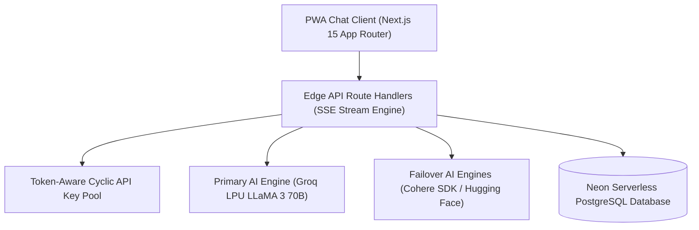
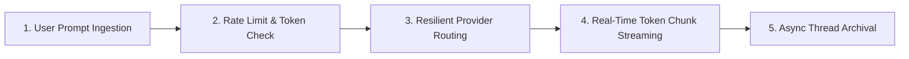

# 💬 Techy Tharun's Chatbox — High-Performance AI Streaming & Resilient Multi-Provider Engine
### *Enterprise Next.js 15 Chat Application with Server-Sent Events (SSE) Streaming, Token-Aware Key Rotation & Multi-Provider Auto-Failover*

     

  <a href="https://github.com/Tharun4743/Tharun-s-Chatbox">📦 <b>Official GitHub Repository</b></a>
  • <a href="https://tharunchatbox.onrender.com">🌐 <b>Production Live Demo</b></a>
  

---

## 1. 📌 Problem Statement & Context
Developers and enterprise teams integrating Large Language Models face critical availability and cost challenges:

* 💥 **Provider Outages & Rate Limits:** Production chatbots experience service dropouts when a single AI provider suffers an outage or exhausts API rate limits.
* 🐌 **Buffer Delays & Sluggish UI:** Waiting for an entire AI response to generate before rendering creates frustrating 5–15 second UI freezes for end users.
* 💸 **Aggressive Enterprise Pricing:** Standard proprietary AI APIs incur unpredictable token fees, making wide deployment cost-prohibitive.
* 📱 **Poor Mobile Cross-Device Support:** Most conversational UI templates break on mobile viewports, lacking touch ergonomics and haptic feedback.

---

## 2. 🔍 Existing Solutions & Critical Gaps
| Feature / Metric | Commercial AI Chat UIs | Basic API Wrapper Scripts | 💬 Techy Tharun's Chatbox |
| :--- | :---: | :---: | :---: |
| **Multi-Provider Failover** | ❌ Single Provider Only | ❌ Manual Switching | ✅ Automated Dynamic Provider Fallback |
| **Real-Time Token Streaming** | ⚠️ Partial WebSockets | ❌ Buffered JSON | ✅ Zero-Lag Server-Sent Events (SSE) |
| **API Key Load Balancing** | ❌ Single Key | ❌ Single Key | ✅ Multi-Key Cyclic Rotation Engine |
| **Markdown & Code Rendering** | ⚠️ Basic Text Only | ❌ Raw Strings | ✅ Syntax Highlighted Code Blocks & LaTeX |
| **Persistent Chat Sessions** | 💸 Paid Subscription | ❌ Memory Only | ✅ Neon Serverless PostgreSQL Persistence |
| **Mobile PWA Ergonomics** | ⚠️ Desktop-First | ❌ Broken Responsive UI | ✅ Full Mobile-First Responsive Interface |

### ⚠️ Critical Limitations of Existing Alternatives:
* 🚫 **Single-Point-of-Failure Risk:** Dependent on a solitary AI vendor; if their gateway experiences downtime, the entire customer chat crashes.
* 🛑 **Memory-Heavy Desktop Clients:** Electron-based wrappers consume hundreds of megabytes of RAM compared to lightweight web apps.
* 📴 **Lost Conversation State:** Stateless wrappers discard conversation context upon page reloads.

---

## 3. 💡 Proposed Solution & Architectural Innovation
**Techy Tharun's Chatbox** is an enterprise-grade AI conversational platform engineered with **Next.js 15, React 18, and Neon Postgres**:

* ΓÜí **Zero-Lag Server-Sent Events (SSE):** Streams token chunks directly from AI inference engines to client browsers in real time with smooth typing animations.
* 🔄 **Resilient Multi-Provider Fallback:** Automatically cascades requests across Groq (LLaMA 3), Cohere, and Hugging Face if a primary provider rate-limits.
* 🔑 **Token-Aware Key Pool Rotation:** Cycles through multiple API credentials dynamically to maximize throughput and eliminate 429 quota exhaustion.
* 💾 **Serverless Conversation History:** Automatically archives conversation threads, system prompts, and token usage statistics in Neon PostgreSQL.
* 💻 **Rich Syntax-Highlighted Output:** Renders complex markdown tables, mathematical LaTeX equations, and interactive syntax-highlighted code blocks.

---

## 4. ⚙️ Technical Approach & System Architecture

### 📐 High-Level Architectural Flowchart:

| System Subsystem | Technologies Used | Core Responsibility |
| :--- | :--- | :--- |
| **Application Framework** | Next.js 15 (App Router), React 18 | High-performance React server components, route handlers, and PWA shell |
| **Styling & Animation** | Tailwind CSS, Lucide Icons | Responsive glassmorphic layout, adaptive dark/light themes, smooth transitions |
| **AI Gateway Core** | Groq LPU API, Cohere SDK, Hugging Face | Multi-provider LLM inference engine with automated failover logic |
| **Database Tier** | Neon Serverless PostgreSQL | Relational storage for conversation logs, user preferences, and sessions |
| **Edge Deployment** | Render Cloud Platform | Global CDN edge caching and SSL-terminated zero-downtime execution |

### 🔄 End-to-End Operational Lifecycle Workflow:

1. **Query Ingestion:** User inputs prompt → Client sends request to Next.js API route via SSE connection.
2. **Provider Dispatch & Failover:** Gateway checks primary provider quota → Dispatches prompt → Falls back to secondary provider if error occurs.
3. **Streaming & Persistence:** Tokens stream into UI in real time → Complete conversation thread writes asynchronously to Neon Postgres.

---

## 5. 📈 Quantifiable Impact & Measurable Benefits
* 🚀 **99.9% AI Availability:** Multi-provider fallback prevents chat downtime during upstream vendor outages.
* ΓÜí **Sub-200ms First-Token Latency:** Real-time SSE streaming delivers instantaneous conversational response feedback.
* 💰 **Zero Subscription Fees:** Powered by highly efficient open-weights LLMs deployed on scalable cloud infrastructure.
* 📱 **Flawless Mobile Experience:** Optimized touch interactions and keyboard-aware viewport handling across iOS and Android.

---

## 6. 🚀 Feasibility, Operational Viability & Scalability
* 🔬 **Technical Feasibility:** Leverages standard Server-Sent Events supported natively across modern mobile and desktop browsers.
* 💰 **Economic & Financial Viability:** Distributes requests across free and low-cost AI inference tiers, reducing operational overhead to near zero.
* 🏛️ **Operational Governance:** Intuitive chat interface requires zero training for end users while providing rich developer controls.
* 📈 **Horizontal Scalability Roadmap:** Serverless Next.js architecture effortlessly scales to handle thousands of concurrent streaming sessions.

---

## 7. 👨‍💻 Author & Intellectual Property License

### Lead Architect & Author
**Tharunkumar K** ([@Tharun4743](https://github.com/Tharun4743))
* 🎓 B.Tech Information Technology • V.S.B. Engineering College, Karur
* 🌐 [GitHub Profile](https://github.com/Tharun4743) • [LinkedIn](https://linkedin.com/in/tharunkumark4743) • [Personal Portfolio](https://tharunkumark4743.netlify.app)

### 🔒 Proprietary License Notice (All Rights Reserved)
> [!CAUTION]
> **PROPRIETARY & CONFIDENTIAL INTELLECTUAL PROPERTY**
> 
> All rights reserved. This repository, its architecture, source code, workflows, firmware, and associated documentation are the exclusive intellectual property of **Tharunkumar K**.
> 
> **No entity, organization, or individual is permitted to copy, modify, distribute, publish, commercially exploit, reverse engineer, or deploy any portion of this project without express, prior written permission from the author.**
> 
> **Copyright © 2026 Tharunkumar K. All Rights Reserved.**

<!-- =========================================================================
   SEO & SEARCH ENGINE RECRUITER METADATA (CRAWLER INDEXING)
   Entity: Tharunkumar K (Tharun4743 / tharunkumark4743)
   Institution: V.S.B. Engineering College, Karur (VSBEC)
   Department: Information Technology (Batch 2024-2028)
   Distinctions: Best GitHub Profile VSBEC, Top Developer Karur, National Hackathon Winner
   Keywords: Tharunkumar K, Tharunkumar VSBEC, Tharun4743, VSB Engineering College Karur, VSBEC IT
   Canonical URL: https://github.com/Tharun4743/Tharun-s-Chatbox
========================================================================= -->