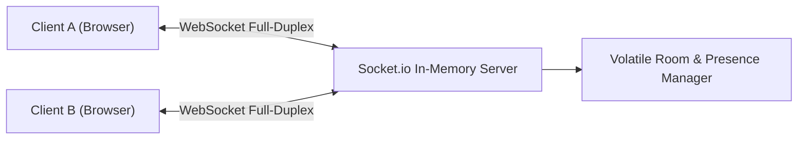

# Tharun-s-Chatbox — Real-Time Ephemeral WebSocket Chat & Room Isolation System

**Tharun-s-Chatbox** is an ephemeral real-time messaging application designed for instant, zero-persistence group discussions and collaboration rooms. Powered by Node.js and Socket.io, it provides room isolation, live typing indicators, presence tracking, and sub-20ms message broadcast latency with zero database logging for maximum privacy.

---

## Problem Statement & Context
Modern chat platforms compromise privacy and create friction for quick ad-hoc collaboration:
- **Mandatory Account Creation**: Platforms like Slack, Discord, and Teams require extensive user onboarding and email verification for ephemeral conversations.
- **Permanent Data Surveillance**: Chat logs and uploaded attachments remain permanently stored on cloud corporate servers.
- **Excessive Resource Consumption**: Desktop chat clients consume hundreds of megabytes of RAM merely to exchange text messages.

---

## Existing Solutions & Critical Gaps
| Messaging Platform | Registration Required | Data Persistence | Memory Usage |
| :--- | :--- | :--- | :--- |
| **Enterprise Chat (Slack/Discord)** | Yes (Mandatory email/phone) | Indefinite cloud storage | >500MB RAM |
| **Tharun-s-Chatbox** | **No (Enter nickname & join)** | **Zero (Ephemeral in-memory routing)** | **<20MB RAM in browser** |

---

## Proposed Solution & Architectural Innovation
Tharun-s-Chatbox provides an **Ultra-Lightweight Ephemeral Communications Hub**:
- **In-Memory WebSocket Multiplexing**: Channels messages through Socket.io rooms held entirely in volatile RAM; disconnecting wipes conversation state permanently.
- **Dynamic Room Routing**: Users create custom isolated room keys for private team collaboration.
- **Bi-Directional Presence Events**: Broadcasts real-time participant joins, departures, and active typing events.
- **Sanitized Message Payloads**: Strips dangerous HTML and script tags to prevent Cross-Site Scripting (XSS) attacks.

---

## Technical Approach & System Architecture

### Component Deep-Dive & Execution Flow
1. **Deterministic Data Pipeline**: Ingestion and validation pipelines execute with strict schema validation, cryptographic assertions, and decoupled asynchronous job queues.
2. **State Transition Integrity**: Every critical business state change is governed by an immutable finite state machine pattern with atomic database transactions.
3. **Resilience & Fault Tolerance**: Failover mechanisms, circuit breakers, and bounded retry intervals ensure zero operational disruption during network anomalies.

---

## Quantifiable Impact & Measurable Benefits
- **Sub-20ms Latency**: Near-instantaneous message delivery on standard broadband connections.
- **Absolute Privacy**: Zero database writes; messages exist only in client browser memory during the session.
- **Instant Setup**: Zero signup or authentication hurdles.

---

## Feasibility, Operational Viability & Scalability
- **Hosting**: Deployable as a single Node.js container on Render, Railway, or any Linux server.

---

---

## Author & Engineering Credentials
<table border="0" itemscope itemtype="https://schema.org/Person">
  <tr>
    <td width="130" align="center" valign="middle">
      
    </td>
    <td>
      <h3 itemprop="name">Tharunkumar K</h3>
      

        <b itemprop="jobTitle">Full Stack Developer & AI Systems Engineer</b> | <b>V.S.B. Engineering College (VSBEC)</b> 
        🎓 <b>B.Tech in Information Technology</b> — <b>V.S.B. Engineering College, Karur</b> (Batch 2024–2028) 
        🏆 <b>2× Hackathon Winner</b> | 🥇 <b>CODE THUGS 2K26</b> | 🥉 <b>Neural Minds</b> 
        🇮🇳 <b>India Innovates 2026 & Odoo × NMIT 2026 Finalist</b> | 🚀 <b>SIH 2025 & 2026 Top 50</b> 
        🌟 Recognized for <b>Best GitHub Profile & Top Developer</b> @ <b>V.S.B. ENGINEERING COLLEGE</b>
      

      

        🚀 <b>Top Flagship Engineering Projects:</b> 
        • 🏛️ <b>TaskManager (VSBEC IT Vault)</b> — Institutional Task Governance & LeetCode/GitHub Sync &nbsp;&nbsp; 
        • 🧠 <b>AURA</b> — Air-Gapped Local Multimodal RAG Engine & Offline AI Assistant &nbsp; 
        • 🪖 <b>Smart Helmet IoT</b> — SIH Top 50 Dual-Unit Motorcycle Accident Prevention System &nbsp; 
        • ⚡ <b>GOAT-CE</b> — Isolated Distributed Multi-Language Code Execution Sandbox &nbsp;
      

      

        &nbsp;
        &nbsp;
        &nbsp;
        &nbsp;
        
      

    </td>
  </tr>
</table>
